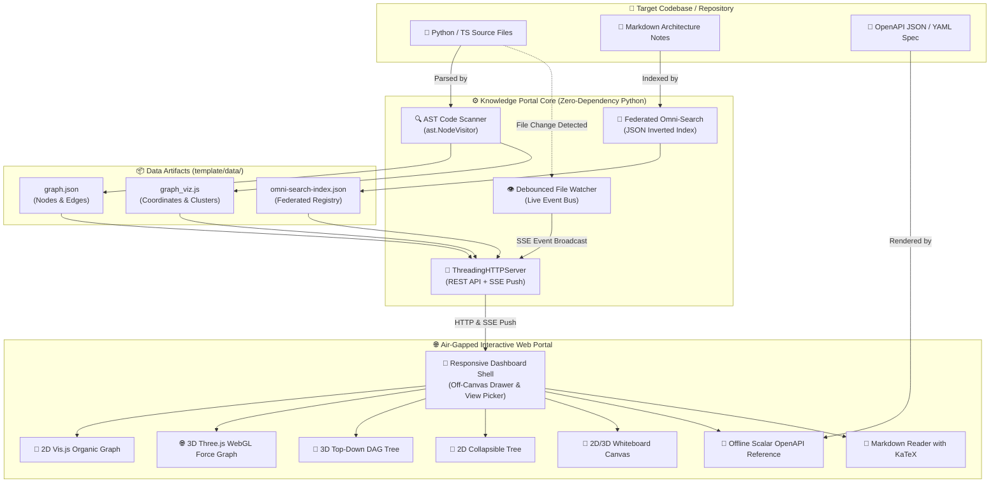
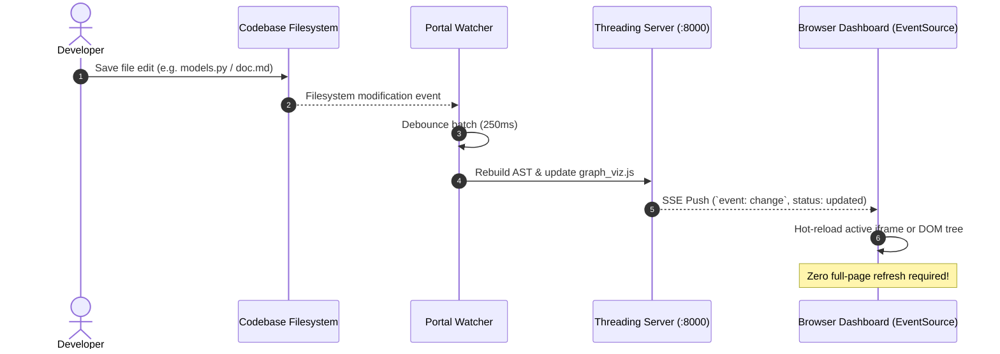

# 🌌 Knowledge Portal

> **Universal Interactive Software Architecture, Multi-Dimensional AST Knowledge Graph & Air-Gapped Documentation Engine**

[](https://github.com/andreafinazziinfo/knowledge-portal/actions)
[](LICENSE)
[](https://www.python.org/)
[](https://github.com/astral-sh/ruff)
[](http://mypy-lang.org/)
[](https://github.com/PyCQA/bandit)
[](#-air-gapped-architecture--zero-telemetry)

---

## 📖 Overview

**Knowledge Portal** is an autonomous, self-contained developer portal and architectural intelligence platform. It scans your source code using Abstract Syntax Tree (AST) analysis and instantly transforms static repositories into a **live, multi-dimensional knowledge universe**:

- **🌌 2D & 3D Interactive Force Graphs**: Navigate codebases volumetrically via WebGL (Three.js) or organically via 2D network physics (Vis.js).
- **🌲 Hierarchical DAG & Tree Navigators**: Inspect module structures, class hierarchies, and call relationships in collapsible or top-down 3D graphs.
- **🔌 Air-Gapped Offline Scalar OpenAPI Catalog**: Explore and test REST APIs directly inside an embedded, zero-CDN `@scalar/api-reference` suite.
- **⚡ Native SSE Live-Reload Push**: File modifications trigger instantaneous AST updates and browser sync over HTTP Server-Sent Events without manual page reloads.
- **📱 Responsive Mobile-First Architecture**: Off-canvas drawer, gesture-friendly canvas, and quick-picker (`⚡ Viste ▾`) tailored for desktops, tablets, and smartphones.
- **🛡️ Zero-Dependency Core Runtime**: The server, watcher, and Python AST scanner rely strictly on the **Python 3.10+ Standard Library** (zero heavy framework dependencies).

---

## 🏛️ System Architecture



---

## 🔄 Live-Reload & Event-Driven Topology

Knowledge Portal provides sub-second live feedback when modifying code, markdown docs, or API specifications:



---

## 🗂️ View Catalog (21 Interactive Views)

| Category | View Name | Engine / Tech | Purpose & Capabilities |
|---|---|---|---|
| **🌌 Graphs & 3D** | **2D Network Graph** | Vis.js Canvas | Interactive physics-based network; clustering by module, degree metrics, search filters. |
| | **3D WebGL Force Graph** | Three.js / WebGL | Volumetric 3D constellation with orbit, zoom, and spatial community grouping. |
| | **2D Whiteboard Canvas** | HTML5 Canvas | Conceptual freehand canvas for architectural mapping and component grouping. |
| | **3D WebGL Canvas** | Three.js Volumetric | 3D visual workspace mapping architectural entities across spatial planes. |
| | **Collapsible Tree** | DOM SVG Hierarchy | Expandable directory hierarchy showing classes, methods, and functions. |
| | **3D Top-Down DAG Tree** | Three.js Directed Graph | Rooted directed acyclic graph layout illustrating dependencies top-to-bottom. |
| | **Full Organic Network** | Vis.js Standalone | Fullscreen graph view with embedded filter sidebar and community legend. |
| **🏗️ Architecture & Flows** | **Floorplan Full-Stack Map** | SVG Hotspot Canvas | High-level infrastructure floorplan with clickable service boundaries. |
| | **Database Lineage & Schema** | Canvas Relational | Table relations, foreign keys, triggers, and entity-relationship lineage. |
| | **Async & WebSocket Topology** | Real-Time Flow Map | Pub/Sub channels, worker queues, and event-driven network flows. |
| | **Frontend UI State Stores** | State Hierarchy | Pinia / Vue / React store reactivity, state mutations, and component bindings. |
| | **Background Worker Tasks** | Queue Architecture | Task schedules, worker pools, queues, and async job routing. |
| | **Data Ingestion Pipeline** | Pipeline Stream Map | Ingestion connectors, stream rate-limiters, deduplication, and storage. |
| **📜 Governance & API** | **Scalar API Catalog** | `@scalar/api-reference` | Air-gapped offline OpenAPI reference with interactive request playground. |
| | **Architecture Decision Records (ADR)** | Markdown Vault | Versioned governance log documenting architectural decisions, trade-offs, and status. |
| | **Engineering Constitution (9 Pillars)** | Quality Framework | Operational engineering principles, circuit breakers, idempotency, and audit standards. |
| | **Threat Matrix & Security** | Risk Grid | Threat vectors, mitigation boundaries, blast radius isolation, and secret guards. |
| | **Operations Incident Runbook** | Ops Playbook | Disaster recovery routines, telemetry diagnosis, and emergency response procedures. |
| | **Interactive Visual Explainers** | Animated SVG / HTML | Step-by-step interactive walkthroughs explaining complex system flows. |
| | **Markdown Knowledge Reader** | Marked.js + KaTeX | Fast documentation viewer with LaTeX math typesetting, backlinks, and editor. |
| | **Terminal Console** | CLI Interface | Interactive embedded console to run diagnostic tests and inspection commands. |

---

## ⚡ Quickstart

### 1. Installation

```bash
# Clone the repository
git clone https://github.com/andreafinazziinfo/knowledge-portal.git
cd knowledge-portal

# Install in editable mode
pip install -e .
```

### 2. Scan your Codebase

```bash
# Scan any target project directory (generates graph.json and search indices)
knowledge-portal scan /path/to/your/project

# Example on the bundled sample project:
knowledge-portal scan sample_project --output template/data
```

### 3. Launch the Portal

```bash
# Start the threaded web server with SSE live-reload on port 8000
knowledge-portal serve --port 8000 --dir sample_project
```

### 4. Static Zero-Server Export (GitHub Pages)

```bash
# Export self-contained static site with pre-calculated graphs and omni-search
knowledge-portal export /path/to/your/project --output ./dist --name "My Project"

# The dist/ directory can be opened locally via file:// or pushed directly to GitHub Pages!
```

### 5. Run with Docker

```bash
# Pull and run the official lightweight multi-arch Alpine container (< 50MB)
docker run -d -p 8000:8000 -v $(pwd):/app/data ghcr.io/andreafinazziinfo/knowledge-portal:latest
```

📖 **Per la guida operativa completa consulta il [Manuale Operativo](docs/MANUALE_OPERATIVO.md).**

Open **`http://localhost:8000/dashboard.html`** in your browser.

---

## 💻 CLI Command Reference

The `knowledge-portal` CLI provides modular subcommands:

```text
usage: knowledge-portal [-h] {scan,serve,audit} ...

Knowledge Portal — Universal Interactive Software Architecture & AST Knowledge Engine

positional arguments:
  {scan,serve,audit}  Available commands
    scan              Scan codebase AST and generate graph data
    serve             Start the Knowledge Portal HTTP server with SSE live-reload
    audit             Run Zero-Proprietary Sanitization Audit

options:
  -h, --help          Show this help message and exit
```

### `knowledge-portal scan`
```bash
knowledge-portal scan [path] [--output OUTPUT_DIR]
```
- `path`: Target codebase directory to analyze (default: current directory).
- `--output`, `-o`: Directory where `graph.json`, `graph_viz.js`, `config.js`, and `GRAPH_REPORT.md` are saved.

### `knowledge-portal serve`
```bash
knowledge-portal serve [--host HOST] [--port PORT] [--dir PROJECT_DIR]
```
- `--host`: Network interface to bind (default: `0.0.0.0`).
- `--port`, `-p`: Port to listen on (default: `8000`).
- `--dir`, `-d`: Working project directory containing markdown notes and source files.

### `knowledge-portal audit`
```bash
knowledge-portal audit [path]
```
Runs the automated zero-proprietary and OPSEC security validator across the target directory, ensuring no secret keys, credentials, private IPs, or internal tokens are accidentally committed.

---

## 🔒 Air-Gapped Architecture & Zero Telemetry

Knowledge Portal was designed from the ground up for **air-gapped and high-security enterprise environments**:

1. **100% Local Vendor Bundles**:
   - Scalar API Reference (`template/vendor/scalar.api-reference.js`)
   - Three.js & 3D Force Graph (`template/assets/3d-force-graph.min.js`)
   - Vis.js Network (`template/vendor/vis-network.min.js`)
   - KaTeX Math Typesetting (`template/vendor/katex/`)
   - FontAwesome Icons & Local Typography
2. **Zero Outbound Network Calls**: No CDN tracking, external telemetry, third-party analytics, or cloud dependencies. The portal functions identically on an air-gapped subnet, internal VPN, or off-grid workstation.
3. **Automated OPSEC Gate**: Includes [`verify_sanitization.py`](verify_sanitization.py) to prevent accidental data leaks in open-source distributions.

---

## 🧪 Testing & CI / CD

Knowledge Portal enforces strict code quality and security standards in GitHub Actions:

- **Linting**: [Ruff](https://github.com/astral-sh/ruff) for rapid, comprehensive style enforcement.
- **Type Checking**: [Mypy](https://mypy-lang.org/) for complete type safety across all AST scanner and server modules.
- **Security Audit**: [Bandit](https://github.com/PyCQA/bandit) automated AST vulnerability scanner + `verify_sanitization.py`.
- **E2E & Unit Tests**: Automated scans on sample codebases validating graph schema integrity and API route responses.
- **Automated Hygiene**: [Dependabot](.github/dependabot.yml) checks weekly for Python and GitHub Actions updates.

Run tests locally:
```bash
# Run sanitization audit
python3 verify_sanitization.py .

# Run linter
ruff check knowledge_portal

# Run type checker
mypy knowledge_portal --ignore-missing-imports
```

---

## 🤝 Contributing

Contributions are welcome! Whether it's adding new visual analyzers, multi-language AST parsers, or UI enhancements:

1. Fork the repository.
2. Create your feature branch (`git checkout -b feat/my-new-view`).
3. Commit your changes (`git commit -m 'feat: add interactive sequence diagram view'`).
4. Push to the branch (`git push origin feat/my-new-view`).
5. Open a Pull Request.

Please ensure all tests and `verify_sanitization.py` pass before opening PRs.

---

## 📄 License

This project is licensed under the **Apache License, Version 2.0**. See the [LICENSE](LICENSE) file for details.
