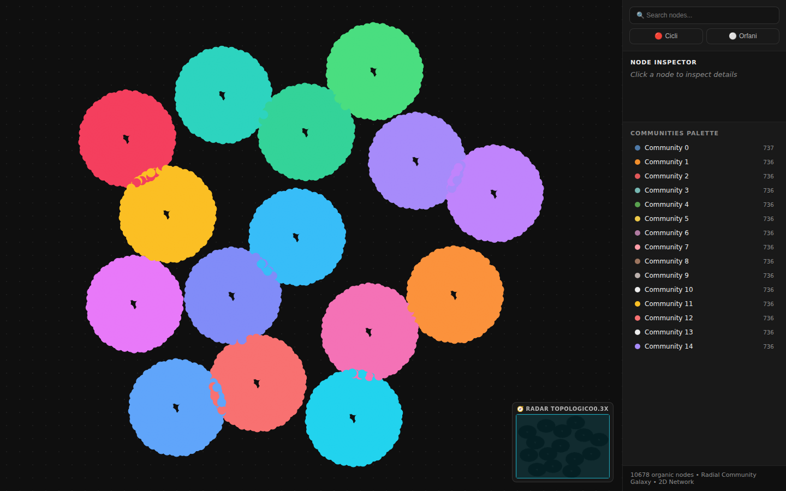
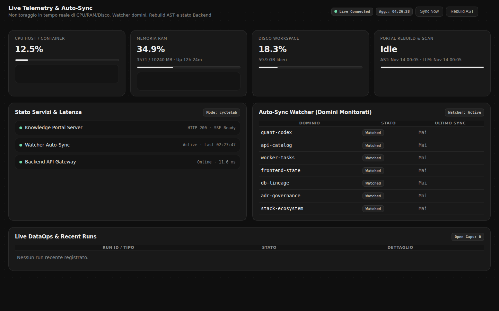
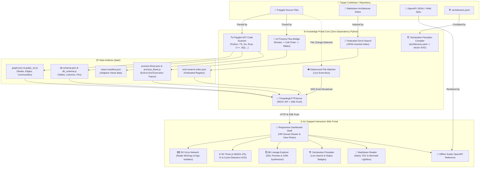
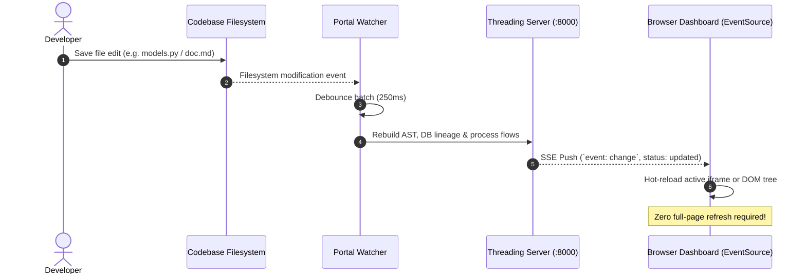

# 🌌 Knowledge Portal

> **Universal Interactive Software Architecture, Multi-Dimensional AST Knowledge Graph, AI Process Flow Engine & Air-Gapped Documentation Suite**

[](https://github.com/andreafinazziinfo/knowledge-portal/actions)
[](LICENSE)
[](https://www.python.org/)
[](https://github.com/astral-sh/ruff)
[](http://mypy-lang.org/)
[](https://github.com/PyCQA/bandit)
[](https://github.com/andreafinazziinfo/knowledge-portal/releases)
[](#-air-gapped-architecture--zero-telemetry)

---

## 📖 Overview

**Knowledge Portal** is an autonomous, self-contained developer portal and architectural intelligence platform. It scans your source code using Abstract Syntax Tree (AST) analysis and instantly transforms static repositories into a **live, multi-dimensional knowledge universe**:

- **🗺️ Radar Minimap & Ego-Network (2D Vis.js)**: Navigate large-scale topologies with a real-time world radar minimap. Isolate selected nodes and their 1-hop/2-hop neighborhood with one click to cut clutter in massive codebases.
- **🚀 3D WebGL Fly-To Camera & HUD Analytics (Three.js)**: Explore 3D force-directed networks with smooth camera tweening (Fly-To), interactive inspector cards, live Depth-First Search cycle detection (`🔴 Cicli`), and orphan finder (`⚪ Orfani`).
- **📑 Smart Markdown Reader with TOC & Mermaid Lightbox**: Collapsible sticky Table of Contents (TOC) with smooth scrolling, one-click code copy buttons, and full-screen vector SVG Mermaid diagrams with interactive zoom.
- **🗄️ Database Lineage with SQL DDL & JOIN Synthesizer**: Interactive ER catalog supporting 10 languages and raw SQL. Features live DDL SQL preview (`CREATE TABLE` with PKs and FKs), automated multi-table `JOIN` query generation, and JSON schema export.
- **🏗️ Declarative Interactive Floorplan (Zero Dependencies)**: Vector SVG architectural floorplan compiler with real-time microservices search, layer isolation toggles, and service lifecycle status badges (`active`, `dev`, `frozen`, `deprecated`).
- **🤖 AI Process Flow Bridge**: Generates end-to-end execution maps (`process-flows.json` & `process_flows.js`) linking API routes and CLI entrypoints to intermediary call chains and SQL database tables, elevating AI agent comprehension to ~98%.
- **🔌 Air-Gapped Offline Scalar OpenAPI Catalog**: Explore and test REST APIs directly inside an embedded, zero-CDN `@scalar/api-reference` suite.
- **⚡ Native SSE Live-Reload Push**: File modifications trigger instantaneous AST updates and browser sync over HTTP Server-Sent Events without manual page reloads.
- **🎨 Unified Carbon-Black Floorplan Design System**: Every view shares the `#0f0f0f` dot-grid canvas, `#191919` surfaces, transparent gradient headers, crisp white hover borders, monochrome active controls, and `/` + `Esc` keyboard ergonomics.
- **📡 Live Telemetry & Auto-Sync (`views/live-telemetry.html`)**: Real-time `/api/telemetry` dashboard with CPU/RAM/Disk sparklines, rebuild progress bars, service latency probes, and graceful offline fallback (`Static Snapshot`).
- **📊 Offline Perspective WASM Pivot Explorer (`views/data-explorer.html`)**: Air-gapped WebAssembly data grid and pivot analytics for architecture nodes, metrics, and schemas.
- **🛡️ Production-Grade Hardening & CI E2E Gate**: Strict path-confinement (`safe_resolve_under`), `PORTAL_READ_ONLY` & `PORTAL_API_TOKEN` guards, HTTP security headers, hardened `read_only` non-root Docker Compose, `pytest-cov` coverage gate, and automated Playwright E2E checks.
- **🛡️ Zero-Dependency Core Runtime**: The server, watcher, and Polyglot AST scanner rely strictly on the **Python 3.10+ Standard Library** (zero heavy framework dependencies).

---

## 🖼️ Visual Showcase

| Interactive Floorplan (SVG) | 2D Community Galaxy Graph |
|---|---|
|  |  |

| 3D WebGL Graph (Transparent Dot-Grid) | Live Telemetry & Auto-Sync |
|---|---|
|  |  |

| Tech Stack & Dependencies Ecosystem | Pivot Data Explorer (WASM Offline) |
|---|---|
|  |  |

---

## 📚 Documentazione & Guide Operative

- 📘 **[Manuale Utente & Guida per Agenti AI](docs/MANUALE_UTENTE_E_AI.md)**: Manuale completo per sviluppatori umani (ergonomia, scorciatoie, comandi) e protocollo di query JSON per agenti autonomi.
- 📖 **[Manuale Operativo e Amministrativo](docs/MANUALE_OPERATIVO.md)**: Guida all'installazione, configurazione server, container Docker e pipeline CI/CD.

---

## 🏛️ System Architecture



---

## 🔄 Live-Reload & Event-Driven Topology

Knowledge Portal provides sub-second live feedback when modifying code, markdown docs, or API specifications:



---

## 🗂️ Interactive Views & Capabilities

| Category | View Name | Technology | Peak Excellence Capability |
| :--- | :--- | :--- | :--- |
| **🌐 Topology** | **2D Organic Network** | Vis.js Physics | Radar minimap with real-time bounding box and ego-network 1/2-hop noise isolation. |
| | **3D WebGL Universe** | Three.js WebGL | Camera fly-to tweening, floating inspector card, DFS cycle detection, orphan node detector. |
| | **Hierarchical DAG** | 3D Collapsible | Top-down tree hierarchy showing module and class inheritance. |
| | **Collapsible Tree** | D3 / 2D Tree | 2D hierarchical navigation tree with search filtering. |
| | **Architecture Floorplan** | Declarative SVG | Real-time microservices search, layer toggles, and status badges (`active`, `dev`, `frozen`, `deprecated`). |
| **🗄️ Database** | **DB Lineage Explorer** | Polyglot SQL AST | Foreign key dependency graph, instant DDL `CREATE TABLE` generator, and automatic SQL `JOIN` generator. |
| **🤖 AI Bridge** | **Process Flow Map** | AST Call Tracing | Maps routes/CLI entrypoints to functions and database tables (`data/process-flows.json`). |
| **📜 Documentation** | **Markdown Reader** | Marked.js + KaTeX | Sticky auto-generated TOC, one-click code copy with visual feedback, Mermaid lightbox zoom. |
| | **Scalar API Catalog** | `@scalar/api-reference` | Air-gapped offline OpenAPI reference with interactive request playground. |
| | **Architecture Decision Records (ADR)** | Markdown Vault | Versioned governance log documenting architectural decisions and status. |
| | **Engineering Constitution** | Quality Framework | Operational engineering principles, circuit breakers, idempotency, and audit standards. |

---

## ⚡ Quickstart

### 1. Installation

```bash
# Clone the repository
git clone https://github.com/andreafinazziinfo/knowledge-portal.git
cd knowledge-portal

# Install in editable mode
pip install -e .
```

### 2. Scan your Codebase

```bash
# Scan any target project directory (generates graph.json, db-schema.json, process-flows.json)
knowledge-portal scan /path/to/your/project

# Example on the bundled sample project:
knowledge-portal scan sample_project --output template/data
```

### 3. Launch the Portal

```bash
# Start the threaded web server with SSE live-reload on port 8000
knowledge-portal serve --port 8000 --dir sample_project
```

### 4. Static Zero-Server Export (GitHub Pages)

```bash
# Export self-contained static site with pre-calculated graphs and omni-search
knowledge-portal export /path/to/your/project --output ./dist --name "My Project"

# The dist/ directory can be opened locally via file:// or pushed directly to GitHub Pages!
```

### 5. Run with Docker

```bash
# Pull and run the official lightweight multi-arch Alpine container (< 50MB)
docker run -d -p 8000:8000 -v $(pwd):/app/data ghcr.io/andreafinazziinfo/knowledge-portal:latest
```

Open **`http://localhost:8000/dashboard.html`** in your browser.

---

## 💻 CLI Command Reference

The `knowledge-portal` CLI provides modular subcommands:

```text
usage: knowledge-portal [-h] {scan,export,floorplan,serve,audit} ...

Knowledge Portal — Universal Interactive Software Architecture & AST Knowledge Engine

positional arguments:
  {scan,export,floorplan,serve,audit}  Available commands
    scan              Scan codebase AST, DB schema, and AI process flows
    export            Export static zero-server bundle ready for GitHub Pages or offline use
    floorplan         Generate interactive vector floorplan from architecture.yaml
    serve             Start the Knowledge Portal HTTP server with SSE live-reload
    audit             Run Zero-Proprietary Sanitization Audit

options:
  -h, --help          Show this help message and exit
```

---

## 🔒 Air-Gapped Architecture & Zero Telemetry

Knowledge Portal was designed from the ground up for **air-gapped and high-security enterprise environments**:

1. **100% Local Vendor Bundles**:
   - Scalar API Reference (`template/vendor/scalar.api-reference.js`)
   - Three.js & 3D Force Graph (`template/assets/3d-force-graph.min.js`)
   - Vis.js Network (`template/vendor/vis-network.min.js`)
   - KaTeX Math Typesetting (`template/vendor/katex/`)
   - FontAwesome Icons & Local Typography
2. **Zero Outbound Network Calls**: No CDN tracking, external telemetry, third-party analytics, or cloud dependencies. The portal functions identically on an air-gapped subnet, internal VPN, or off-grid workstation.
3. **Automated OPSEC Gate**: Includes [`verify_sanitization.py`](verify_sanitization.py) to prevent accidental data leaks in open-source distributions.

---

## 🧪 Testing & CI / CD

Knowledge Portal enforces strict code quality and security standards in GitHub Actions:

- **Linting**: [Ruff](https://github.com/astral-sh/ruff) for rapid, comprehensive style enforcement.
- **Type Checking**: [Mypy](https://mypy-lang.org/) for complete type safety across all AST scanner and server modules.
- **Security Audit**: [Bandit](https://github.com/PyCQA/bandit) automated AST vulnerability scanner + `verify_sanitization.py`.
- **E2E & Unit Tests**: Automated scans on sample codebases validating graph schema integrity, floorplan generator, and process flows.

Run tests locally:
```bash
# Run sanitization audit
python3 verify_sanitization.py .

# Run linter
python3 -m ruff check .

# Run unit tests
python3 -m unittest discover tests/unit -v
```

---

## 🤝 Contributing

Contributions are welcome! Whether it's adding new visual analyzers, multi-language AST parsers, or UI enhancements:

1. Fork the repository.
2. Create your feature branch (`git checkout -b feat/my-new-view`).
3. Commit your changes (`git commit -m 'feat: add interactive sequence diagram view'`).
4. Push to the branch (`git push origin feat/my-new-view`).
5. Open a Pull Request.

Please ensure all tests and `verify_sanitization.py` pass before opening PRs.

---

## 📄 License

This project is licensed under the **Apache License, Version 2.0**. See the [LICENSE](LICENSE) file for details.
